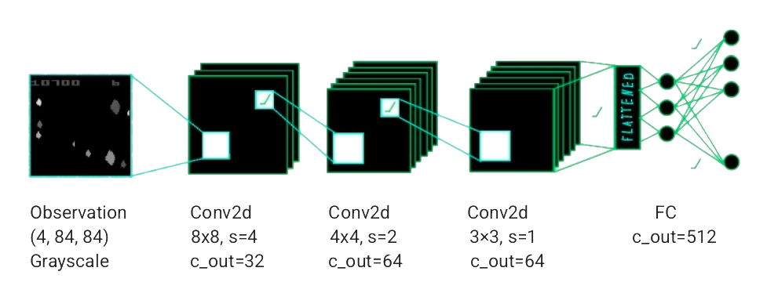
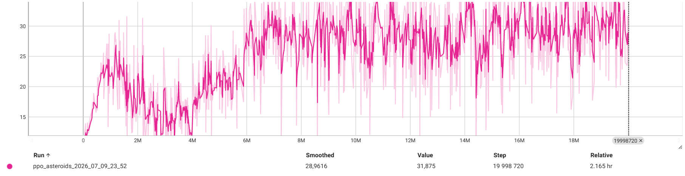
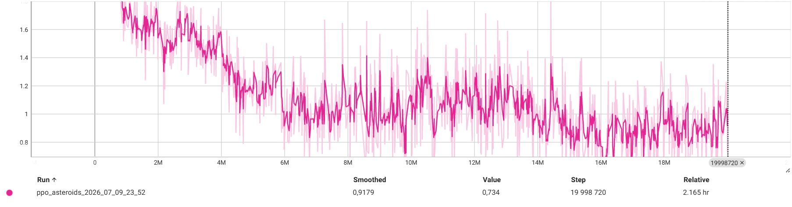

# DeepPPO AtariAsteroids NoFrameSkipV4
Deep Proximal Policy Optimiser RL architecture for Atari Asteroids NoFrameSkipV4 provided by Gymnasium. Implemented in PyTorch.
## Architecture Design

Observation space consists of a frame stack of 84x84 px grayscaled screenshots of the game, fed into the model by the emulator, with the last two frames merged to fix a known Atari Asteroids flicker artefact.

Backbone of the architecture consists of NatureCNN from the paper "Human-level control through deep reinforcement learning" by Volodymyr Mnih, Koray Kavukcuoglu, David Silver et al. It was chosen for its lightweight nature, and the fact, that it was developed exactly for such tasks. 

Then, the policy head has access to the 14-action action space and the Value head maps to a single value prediction.

### Reward Design
Reward function was limited to give unit positive reward upon destroying any target, to prioritise survival over immediate score gain. Episodes were set to end on death, to introduce an implicit harsh penalty for it.

## Training
Adam optimizer was used, being the standard choice for PPO architectures. Learning rate annealing was employed to keep the model from becoming unstable once it learns basic controls.  

Model was trained on 20 Million frames with a rollout buffer of size 256 steps per environment. 8 environments were running in parallel.

TensorBoard logging, early stopping, freezing and continuation from a checkpoint were implemented as well.

## Results
Model achieved an average episode reward of 3300. Detailed metric evolution graphs can be seen below.
### Avarage Clipped Rollout Reward

### Entropy

